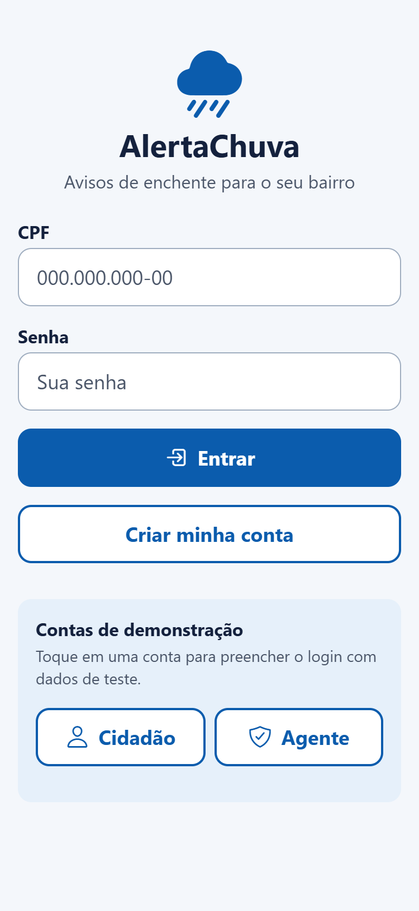
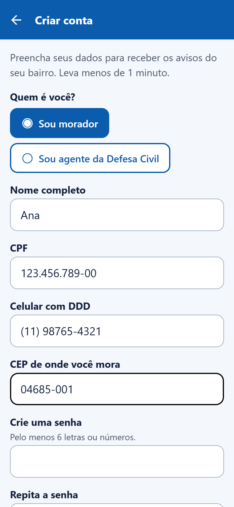
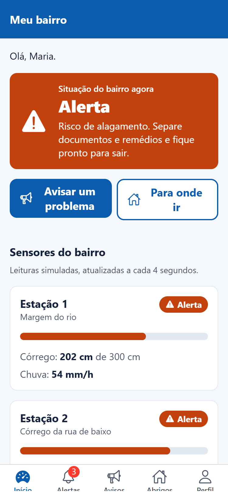
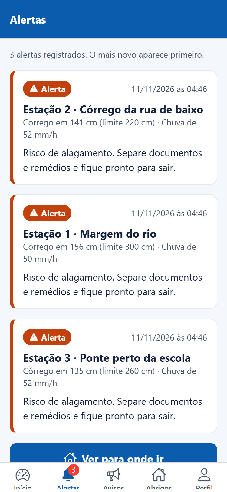
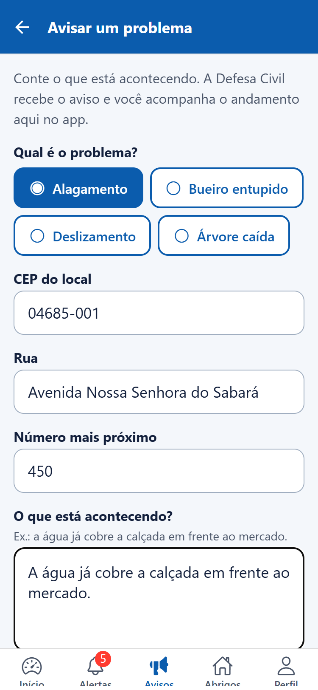
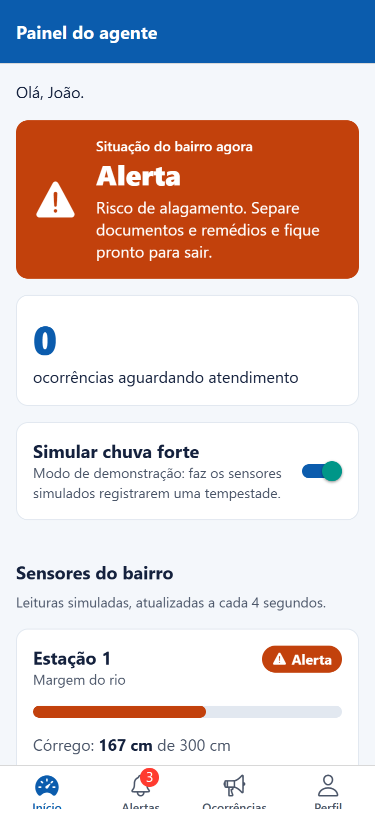

# AlertaChuva

**Global Solution 2026.2 — FIAP | Engenharia de Software | Mobile Development & IoT**

O AlertaChuva é um aplicativo para moradores acompanharem situações de risco de alagamento no bairro. A proposta é reunir avisos de chuva, orientações e registros de ocorrências em um lugar simples de usar, inclusive para quem não tem familiaridade com aplicativos.

Nesta versão, o funcionamento dos sensores e as informações dos pontos de apoio são **simulados**. O projeto é acadêmico e **não substitui os alertas oficiais da Defesa Civil**.

## Ficha da CitizenTech

| Campo | Descrição |
| --- | --- |
| Projeto | AlertaChuva |
| Região escolhida | Vila Sofia, zona sul de São Paulo (SP) |
| Público | Moradores de regiões sujeitas a alagamentos, com atenção a idosos e pessoas com pouca familiaridade com tecnologia |
| Problema | Em períodos de chuva forte, moradores podem não saber a gravidade da situação, como relatar um problema ou onde procurar ajuda. |
| Proposta | Mostrar a situação das estações monitoradas, orientar os moradores e permitir o registro e acompanhamento de ocorrências. |
| Aplicativo | Interfaces para cidadão e agente, formulários, histórico de avisos e leituras simuladas de chuva e nível da água. |
| Integração com a CitizenTech | O aplicativo representa a parte mobile da proposta, que também prevê sensores, serviços de backend e análise de dados nas demais disciplinas. Essas integrações **não estão conectadas nesta versão**. |
| ODS | **11** — Cidades e comunidades sustentáveis; **13** — Ação contra a mudança global do clima; **3** — Saúde e bem-estar. |

### Hipóteses do projeto

- Informações de risco acompanhadas de orientações diretas podem ajudar o morador a agir mais cedo.
- Um formulário curto pode facilitar o registro de alagamentos e outros problemas do bairro.
- O acompanhamento do status de uma ocorrência pode dar mais transparência à solicitação.
- Uma tela específica para agentes pode facilitar a visualização dos registros recebidos.

Essas hipóteses orientam o protótipo. **Ainda não foram validadas em uma implantação real.**

### Indicadores propostos

| Indicador | Como avaliar |
| --- | --- |
| Tempo para registrar uma ocorrência | Cronometrar o preenchimento e o envio durante testes de uso |
| Compreensão dos alertas | Verificar se usuários entendem o nível de risco e a orientação apresentada |
| Quantidade de registros | Contar ocorrências criadas no aplicativo |
| Acompanhamento dos chamados | Medir o tempo entre os status de recebimento e resolução |
| Antecedência dos alertas | Em uma futura integração real, comparar horários do alerta e do evento observado |

## Funcionalidades

**Para moradores:**

- Entrar na conta ou fazer cadastro com validação dos campos.
- Consultar o nível de risco apresentado pelas estações simuladas.
- Ver os alertas registrados e as orientações associadas.
- Cadastrar ocorrências e acompanhar seu andamento.
- Consultar uma lista demonstrativa de pontos de apoio.

**Para agentes:**

- Consultar as ocorrências registradas no aplicativo.
- Atualizar o status dos registros para recebida, em atendimento ou resolvida.
- Ativar e desativar a simulação de chuva forte para demonstrar a mudança nos níveis de risco.

A navegação muda de acordo com o perfil. A interface usa textos curtos, componentes reutilizáveis e identificações de risco por texto, ícone e cor.

### Simulação de sensores

O aplicativo possui três estações fictícias. A cada quatro segundos, os valores de chuva e nível da água são atualizados localmente. O risco é classificado assim:

| Classificação | Regra usada no protótipo |
| --- | --- |
| Normal | Nível abaixo de 60% da cota e chuva abaixo de 25 mm/h |
| Atenção | Nível a partir de 60% da cota ou chuva a partir de 25 mm/h |
| Alerta | Nível a partir de 80% da cota ou chuva a partir de 50 mm/h |
| Emergência | Nível igual ou superior à cota definida para a estação |

Ao subir para **Alerta** ou **Emergência**, uma estação pode gerar um aviso, que passa a aparecer no histórico. Os valores e limites foram definidos para demonstrar o funcionamento da aplicação, e não representam medições ou critérios operacionais oficiais.

### Dados salvos no aparelho

O aplicativo usa **AsyncStorage** por meio de `src/services/storageService.ts` para guardar contas de demonstração/cadastro, sessão, ocorrências, histórico de alertas e modo da simulação. O acesso ao armazenamento fica concentrado na camada de serviços.

**Limitação importante:** as contas e senhas deste protótipo são mantidas localmente, sem backend e sem controle de acesso de produção. O cadastro de agente também é demonstrativo. Não use CPF, senha ou outros dados pessoais reais para testar o aplicativo.

## Rodando o projeto

É necessário ter o **Node.js** instalado e o **Expo Go** no celular, ou um ambiente de emulação configurado.

```bash
npm install
npx expo start
```

Abra o projeto no Expo Go pelo QR code exibido no terminal. Para usar o Android Emulator, pressione `a`; para abrir a versão web, pressione `w`.

Para conferir os tipos TypeScript:

```bash
npm run typecheck
```

Na tela de login, os botões **Cidadão** e **Agente** preenchem contas fictícias para facilitar os testes. Não é necessário cadastrar um CPF real.

## Organização do projeto

```text
App.tsx          Contextos e entrada da navegação
src/
  components/   Componentes compartilhados
  constants/    Níveis de risco e status
  contexts/     Autenticação e estado dos sensores
  hooks/        Estados e ações das telas
  navigation/   Rotas e navegação por perfil
  screens/      Telas do aplicativo
  services/     Armazenamento, autenticação e simulação
  styles/       Tema e estilos por tela/componente
  types/        Tipos TypeScript
  utils/        Máscaras, validações e formatações
assets/         Ícones e imagens do app
docs/prints/    Capturas de tela
```

**Tecnologias:** React Native, Expo, TypeScript, React Navigation, Context API e AsyncStorage.

## Telas

| Login | Cadastro | Início |
| --- | --- | --- |
|  |  |  |

| Alertas | Nova ocorrência | Painel do agente |
| --- | --- | --- |
|  |  |  |

## Vídeo de demonstração

Assista no YouTube: **[https://youtube.com/shorts/7ivxue75JP4](https://youtube.com/shorts/7ivxue75JP4)** (até 3 minutos).

## Integrantes

- Renato Luiz Cordão — RM 556403
- Vitor Victorino Couto — RM 554965
- Victoria Moura — RM 555474
- Fabricio Bettarello — RM 554638
- Enzo Miletta — RM 98677

## Informações para a entrega

- **Repositório no GitHub:** [https://github.com/VicxMouraM/Global-Solution-2026-Mobile-Development-IOT](https://github.com/VicxMouraM/Global-Solution-2026-Mobile-Development-IOT)
- **Vídeo:** [https://youtube.com/shorts/7ivxue75JP4](https://youtube.com/shorts/7ivxue75JP4)
- **Prazo informado na atividade:** 19/11/2026, às 23h55.

O registro de ferramentas utilizadas durante o desenvolvimento está em [`prompts.md`](prompts.md), conforme as orientações gerais da Global Solution.
